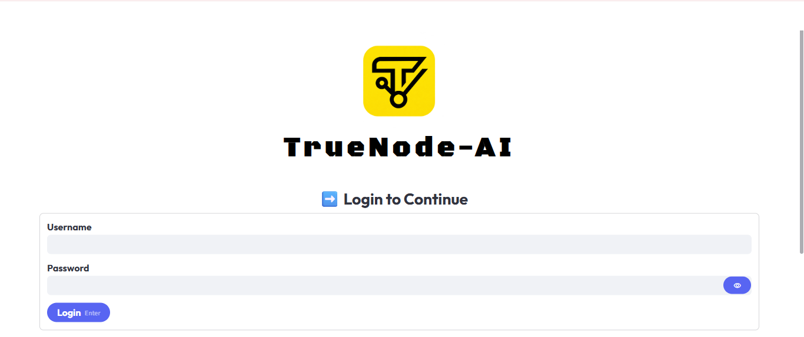
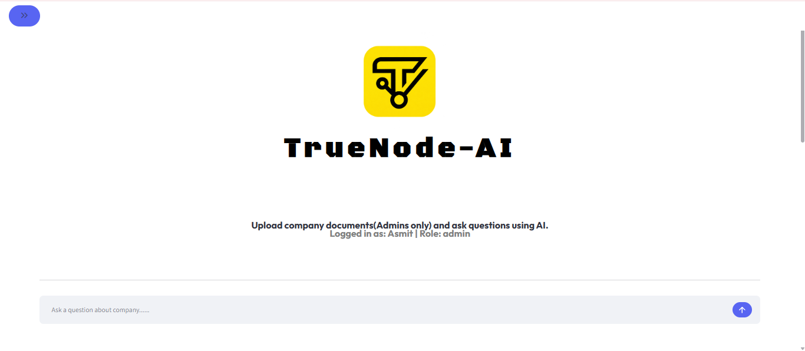
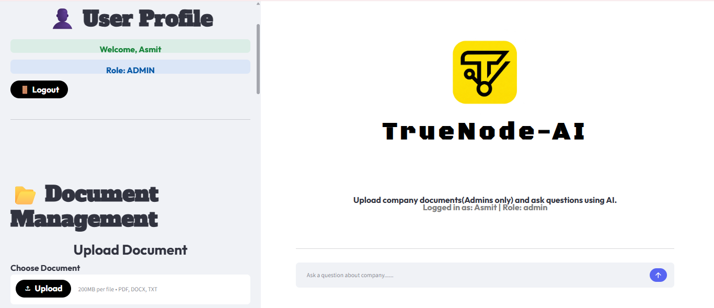
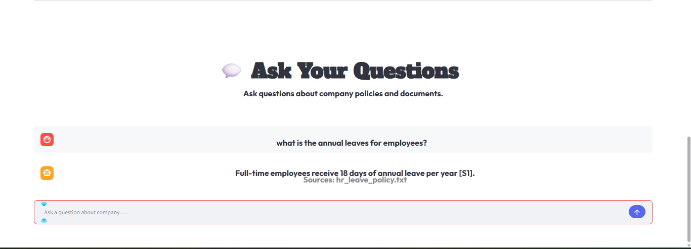
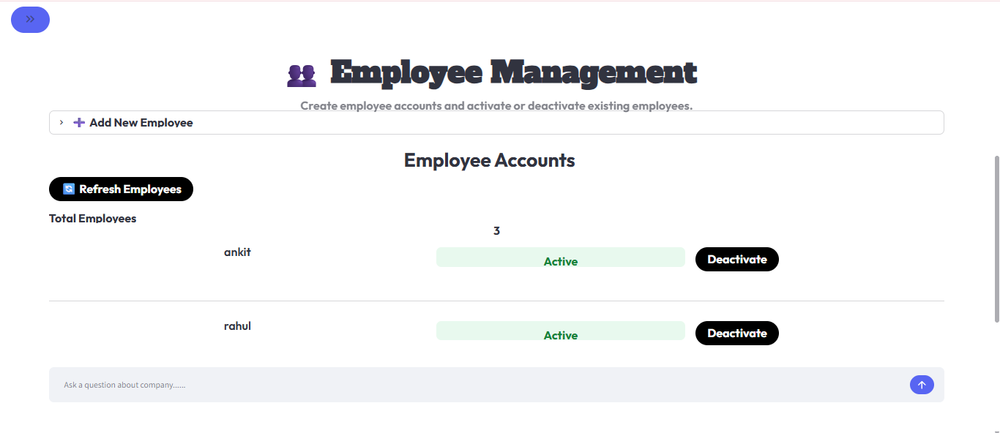
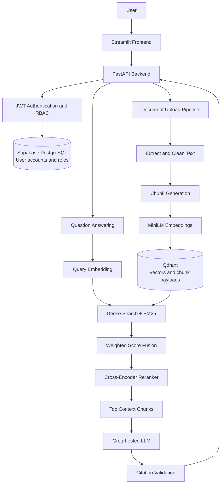

# TrueNode AI — Enterprise Knowledge Assistant

An enterprise-style **Retrieval-Augmented Generation (RAG)** application that allows employees to ask questions about company documents and receive answers grounded in retrieved document content.

The project combines **Streamlit**, **FastAPI**, **Sentence Transformers**, **Qdrant**, **Supabase (PostgreSQL)**, and a **Groq-hosted LLM**. It includes document ingestion, hybrid retrieval, cross-encoder reranking, source citations, JWT authentication, role-based access control, and Admin user management.

> **Project status:** Developed,Dockerized and deployed.CI/CD is planned. This is a portfolio/demo project, not a production-ready enterprise security implementation.

---

## Application Screenshots

### Login Page



### Admin Dashboard



### Document Upload and Management



### Chat Interface



### Employee Management




---

## Key Results

- **MRR@3 = 1.00** for the Hybrid Retrieval + Cross-Encoder configuration on the reported benchmark.
- **Recall@3 = 1.00** on the reported retrieval benchmark.
- **32/32 answerability benchmark checks passed.**
- Answers include source references to retrieved documents.
- JWT authentication and Admin/Employee role-based access control.
- Dual-database design using Supabase for user accounts and Qdrant for vector data and document chunk payloads.

> Evaluation results are specific to the benchmark corpus and should not be interpreted as production performance guarantees.

---

## Features

### Retrieval-Augmented Generation

- **Document ingestion:** Upload PDF, DOCX, and TXT files.
- **Document parsing:** Extract text using PyMuPDF and python-docx.
- **Text cleaning and chunking:** Clean extracted text and split it into retrievable chunks with metadata.
- **Embedding generation:** Generate vector embeddings using `sentence-transformers/all-MiniLM-L6-v2`.
- **Duplicate detection:** Detect duplicate document uploads using content-based checks.
- **Semantic retrieval:** Retrieve relevant chunks from Qdrant.
- **Keyword retrieval:** Retrieve keyword-relevant chunks using BM25.
- **Hybrid retrieval:** Combine dense and BM25 retrieval scores using weighted score fusion.
- **Cross-encoder reranking:** Rerank retrieved candidates before building the LLM context.
- **Grounded question answering:** Generate answers using retrieved document context.
- **Source citations:** Return source document references with answers.
- **Citation validation:** Check citation identifiers against the retrieved context.

### Authentication and User Management

- **JWT authentication:** Token-based login and protected API access.
- **Password hashing:** Passwords are stored as hashes using the configured password-hashing library (Argon2-backed configuration).
- **Role-based access control:** Separate Admin and Employee permissions.
- **Supabase user storage:** Store usernames, password hashes, roles, account status, and creation timestamps in the `users` table.
- **Admin user management:** List users, create employee accounts, and activate/deactivate employee accounts.
- **Endpoint-level authorization:** Protect Admin-only API operations on the backend.

### Document Management

- Admin-only document upload and deletion.
- Authenticated document listing.
- Document chunks and their payload metadata are stored in Qdrant.

---

## Tech Stack

| Layer | Technology |
|---|---|
| Frontend | Streamlit, Requests |
| Backend API | FastAPI, Pydantic, Uvicorn |
| LLM | Groq API |
| Embeddings | `sentence-transformers/all-MiniLM-L6-v2` |
| Vector Database | Qdrant |
| User Database | Supabase (managed PostgreSQL) |
| Semantic Retrieval | Sentence Transformers + Qdrant |
| Keyword Retrieval | BM25 (`rank-bm25`) |
| Retrieval Fusion | Weighted dense + BM25 score fusion |
| Reranking | `cross-encoder/ms-marco-MiniLM-L6-v2` |
| Authentication | JWT |
| Password Hashing | pwdlib / Argon2-backed configuration |
| Document Parsing | PyMuPDF, python-docx |
| Evaluation | Custom benchmark suite |

---

## Architecture



---

## Database Design

The application uses two data stores for different responsibilities.

### Qdrant — Vector and Document Chunk Storage

Qdrant stores:

- Chunk embeddings.
- Chunk text and associated payload metadata.
- Source/document identifiers and chunk-level metadata used during retrieval.
- Data used for semantic search and document listing.

### Supabase — User Account Storage

The current Supabase integration stores application users in the `public.users` table:

- Username.
- Password hash.
- Role (`admin` or `employee`).
- Active/inactive account status.
- Account creation timestamp.

**Important:** In the current implementation, document chunks and document listing metadata are managed through Qdrant. The Supabase `users` table is used for user account management; this README does not claim that document records are stored in Supabase.

---

## Document Ingestion Flow

1. An Admin uploads a PDF, DOCX, or TXT file through the Streamlit interface.
2. The backend validates the file and checks for duplicates.
3. Text is extracted and cleaned.
4. The content is split into retrievable chunks.
5. MiniLM generates an embedding for each chunk.
6. Chunk text, embeddings, and payload metadata are stored in Qdrant.
7. The document becomes available for question answering and document listing.

## Question Answering Flow

1. An authenticated user submits a question.
2. The backend generates an embedding for the query.
3. Dense semantic retrieval is performed using Qdrant.
4. BM25 keyword retrieval identifies lexical matches.
5. Dense and BM25 results are combined using weighted score fusion.
6. A cross-encoder reranks the retrieved candidates.
7. The top-ranked chunks are assembled into context.
8. The context and question are sent to the Groq-hosted LLM.
9. Citation identifiers are validated against retrieved context.
10. The API returns the answer and source references.

## Authentication Flow

1. The user submits a username and password to `POST /auth/login`.
2. The backend retrieves the account from Supabase.
3. The submitted password is checked against the stored password hash.
4. On successful authentication, the backend issues a JWT access token.
5. Protected endpoints validate the token and retrieve the user's current role and account status from Supabase.
6. Admin-only endpoints additionally enforce the Admin role on the backend.

---

## Repository Structure

```text
enterprise_knowledge_ai/
├── backend/
│   ├── api/
│   │   ├── auth.py
│   │   ├── chat.py
│   │   ├── doc_upload.py
│   │   └── user_management.py
│   ├── core/
│   │   ├── resources.py
│   │   ├── security.py
│   │   └── supabase_client.py
│   ├── ingestion/
│   ├── rag/
│   └── main.py
├── frontend/
│   └── app.py
├── UI/
│   ├── fonts.py
│   └── header.py
├── evaluation/
├── scripts/
│   ├── seed_users.py
│   └── test_supabase.py
├── screenshots/
│   ├── login.png
│   ├── admin_dashboard.png
│   ├── document_management.png
│   ├── chat_interface.png
│   └── citations.png
├── data/                       # Local runtime data; do not commit private data
├── requirements.backend.txt
├── requirements.frontend.txt
├── .env                        # Local secrets; do not commit
└── README.md
```

> This is a representative structure. Keep the filenames and folders aligned with the actual repository if you have organized some modules differently.

---

## Installation and Setup

### Requirements

- Python 3.13.
- A Groq API key.
- A Supabase project.
- Internet access for API calls and first-run model downloads.

### 1. Clone the Repository

```powershell
git clone <YOUR_REPOSITORY_URL>
cd enterprise_knowledge_ai

py -3.13 -m venv .venv
.\.venv\Scripts\Activate.ps1
```

### 2. Install Dependencies

```powershell
python -m pip install -r requirements.backend.txt
python -m pip install -r requirements.frontend.txt
```

### 3. Configure Environment Variables

Create a `.env` file in the project root:

```dotenv
GROQ_API_KEY=your_groq_api_key
JWT_SECRET_KEY=generate_a_long_random_secret
SUPABASE_URL=https://your-project.supabase.co
SUPABASE_SECRET_KEY=your_supabase_secret_key
```

For the one-time initial user migration script (`python -m scripts.seed_users`), also provide the existing password hashes:

```dotenv
ADMIN_PASSWORD_HASH=your_admin_password_hash
EMPLOYEE_PASSWORD_HASH=your_employee_password_hash
```

These two hash variables are used by the seed script to populate the initial Admin and Employee records. The application reads user password hashes from Supabase during login.

**Security notes:**

- Never commit `.env` to GitHub.
- Never expose `SUPABASE_SECRET_KEY` in Streamlit code, browser code, screenshots, or public repositories. Keep it on the backend only.
- Do not share API keys, JWT secrets, or password hashes.
- Add `.env`, local database files, uploaded private documents, and other secrets to `.gitignore`.

### 4. Create the Supabase Users Table

Open the Supabase SQL Editor and run:

```sql
CREATE TABLE IF NOT EXISTS public.users (
    id UUID PRIMARY KEY DEFAULT gen_random_uuid(),
    username VARCHAR(100) UNIQUE NOT NULL,
    password_hash TEXT NOT NULL,
    role VARCHAR(20) NOT NULL CHECK (role IN ('admin', 'employee')),
    is_active BOOLEAN NOT NULL DEFAULT TRUE,
    created_at TIMESTAMPTZ DEFAULT NOW()
);

ALTER TABLE public.users ENABLE ROW LEVEL SECURITY;
REVOKE ALL ON TABLE public.users FROM anon, authenticated;
```

The backend connects to Supabase using the secret key stored in its environment. Keep that key private and use it only in trusted server-side code.

### 5. Seed the Initial Admin and Employee Accounts

After adding `ADMIN_PASSWORD_HASH` and `EMPLOYEE_PASSWORD_HASH` to `.env`, run:

```powershell
python -m scripts.seed_users
```

The script inserts or updates the initial `admin` and `employee` records in Supabase. Do not put plain-text passwords in the database or README.

You can verify the records with:

```powershell
python -m scripts.test_supabase
```

### 6. Start the FastAPI Backend

```powershell
python -m uvicorn backend.main:app --reload
```

Swagger documentation:

```text
http://127.0.0.1:8000/docs
```

### 7. Start the Streamlit Frontend

Open a second PowerShell window, activate the virtual environment, and run:

```powershell
python -m streamlit run frontend/app.py
```

Application URL:

```text
http://localhost:8501
```

---

## API Overview

| Method | Route | Access | Purpose |
|---|---|---|---|
| `POST` | `/auth/login` | Public | Authenticate and issue JWT |
| `GET` | `/auth/me` | Authenticated | Return the current user's profile |
| `POST` | `/chat/query` | Authenticated | Ask a question about indexed documents |
| `POST` | `/documents/upload` | Admin | Upload and index a document |
| `GET` | `/documents/` | Authenticated | List indexed documents |
| `DELETE` | `/documents/{id}` | Admin | Delete an indexed document |
| `GET` | `/users/` | Admin | List application users |
| `POST` | `/users/` | Admin | Create an Employee account |
| `PATCH` | `/users/{username}/status` | Admin | Activate or deactivate an Employee account |

### Create an Employee

`POST /users/`

Example request body:

```json
{
  "username": "new_employee",
  "password": "Use-a-strong-password"
}
```

The backend hashes the password before storing the new account in Supabase. The password hash is not returned by the API.

### Activate or Deactivate an Employee

`PATCH /users/{username}/status`

Deactivate:

```json
{
  "is_active": false
}
```

Activate:

```json
{
  "is_active": true
}
```

These user-management endpoints require an Admin JWT. Employee accounts cannot use these Admin-only operations.

---

## Example Query

Example request to `POST /chat/query`:

```json
{
  "question": "How many annual leave days are available?"
}
```

Illustrative response based on the sample HR policy document:

```json
{
  "answer": "Employees receive 18 days of annual leave per year.",
  "sources": [
    "hr_leave_policy.txt"
  ]
}
```

The actual response depends on the documents uploaded to the application and the retrieved context.

---

## Evaluation

The project includes a synthetic benchmark covering:

- Single-document questions.
- Multi-document questions.
- Unanswerable questions.
- Citation validation checks.

### Retrieval Results

| Split | Queries | System | Hit@3 | Recall@3 | MRR@3 |
|---|---:|---|---:|---:|---:|
| Dev | 21 | Semantic | 1.00 | 1.00 | 0.9762 |
| Dev | 21 | Hybrid | 1.00 | 1.00 | 0.9762 |
| Dev | 21 | Hybrid + Cross-Encoder Reranker | 1.00 | 1.00 | 1.00 |
| Test | 7 | Evaluated retrieval systems | 1.00 | 1.00 | 1.00 |

### Additional Benchmark Checks

- Answerability: **32/32** checks passed.
- Citation matching: **4/4** checks passed.
- Multi-document completeness: **2/2** checks passed.

> These results apply only to the benchmark dataset and test setup used for this project. They should not be interpreted as production performance claims or guarantees on unseen enterprise data.

---

## Security Considerations

- JWT-based authentication with token expiration.
- Password hashes are stored in Supabase; plain-text passwords are not stored.
- Admin/Employee role checks are enforced by backend dependencies.
- User status and role are reloaded from Supabase when validating protected requests.
- Supabase secret key is intended for backend use only.
- No document-level access control is currently implemented.
- No tenant isolation is currently implemented.
- Frontend logout clears the locally stored token but does not revoke an already issued JWT. The token remains valid until it expires unless the account is deactivated or another backend-side rejection applies.
- Avoid uploading confidential enterprise data to this demo deployment.
- Never commit `.env`, API keys, password hashes, local database files, or private company documents.

---

## Limitations

- Portfolio/demo security model; additional hardening is required before production use.
- Local-first deployment; hosted deployment is not yet configured.
- Benchmark dataset is limited and synthetic.
- Citation validation checks citation references, not necessarily every factual claim independently.
- No document-level permissions.
- No tenant isolation.
- No JWT refresh-token or server-side token-revocation workflow.
- No production monitoring or observability setup.

---

## Roadmap

- [x] Document ingestion for PDF, DOCX, and TXT.
- [x] Hybrid retrieval using dense and BM25 search.
- [x] Cross-encoder reranking.
- [x] Source citations and citation checks.
- [x] JWT authentication.
- [x] Admin/Employee role-based access control.
- [x] Supabase user account integration.
- [x] Admin user management APIs.
- [x] Streamlit interface.
- [x] Retrieval and answerability evaluation suite.
- [x] Docker deployment.
- [ ] CI/CD pipeline.
- [ ] Production deployment.


---

## Portfolio Focus

This project demonstrates practical implementation of an end-to-end RAG application, including:

- Document ingestion and text-processing pipelines.
- Embedding generation and vector storage.
- Dense semantic and BM25 keyword retrieval.
- Weighted hybrid retrieval fusion.
- Cross-encoder reranking.
- Context-grounded answer generation.
- Source citation handling and validation.
- JWT authentication and role-based access control.
- Supabase-backed user account management.
- Admin user-management workflows.
- Qdrant vector database integration.
- Benchmark-based evaluation.

The goal is to explore practical engineering challenges involved in building a production-inspired enterprise knowledge assistant rather than a basic chatbot.
